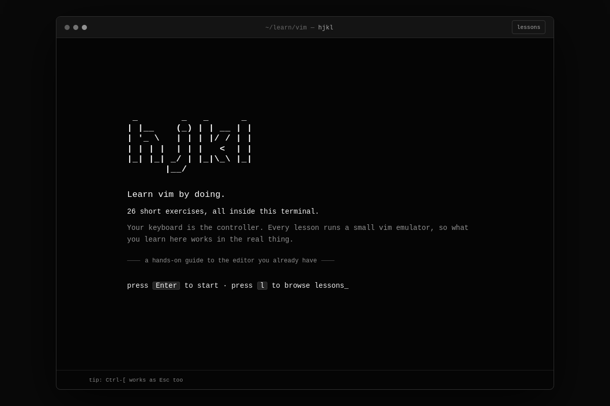

# hjkl

Learn vim by doing: 26 short exercises inside a terminal-styled page, driven by a small vim emulator written from scratch.



## Run

No build step and no dependencies. Open `index.html` in a browser, or serve the folder:

```sh
python3 -m http.server 8000   # then visit http://localhost:8000
```

## Test

```sh
npm test   # node --test tests/
```

The tests cover the emulator and play every lesson's reference solution to make sure each lesson can be completed.

## Layout

- `js/vim.js`: the emulator (modes, motions, operators, text objects, undo, `.`, search, `:s`). No DOM.
- `js/lessons.js`: lessons as data (starting buffer, goal, hint, reference solution).
- `js/runner.js`: runs a lesson: blocked keys, targets, completion check.
- `js/app.js`: rendering, keyboard capture, lesson menu, progress (saved in `localStorage`).

In-app commands: `:next`, `:prev`, `:reset`, `:lessons`, `:lesson N`, `:hint`.
